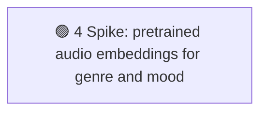

# Initiatives

Planned work for render-core and the experiments.

<!-- brindley:generated:begin — do not edit by hand; regenerate instead -->

### Active

| # | Initiative | Type | Status | Ready / blocked by | Open Qs | Owner |
|---|------------|------|--------|--------------------|---------|-------|
| 4 | [Spike: pretrained audio embeddings for genre and mood](04-spike-pretrained-audio-embeddings-for-genre-and-mood.md) | spike | designed | ✅ ready | 0 | — |

### Dependencies

### Themes

- **music-analysis** — Musical understanding beyond beats: intensity, structure, mood, genre — signals for scripting the visualiser · 1 open, 3 closed or deferred

### Completed

| # | Initiative | Type | Updated |
|---|------------|------|---------|
| 1 | [Music state descriptors and intensity](01-music-state-descriptors-and-intensity.md) | feature | 2026-11-22 |
| 2 | [Song structure events](02-song-structure-events.md) | feature | 2026-11-22 |
| 3 | [Key, mode and mood (arousal/valence)](03-key-mode-and-mood-arousal-valence.md) | feature | 2026-11-22 |

<!-- brindley:generated:end -->
